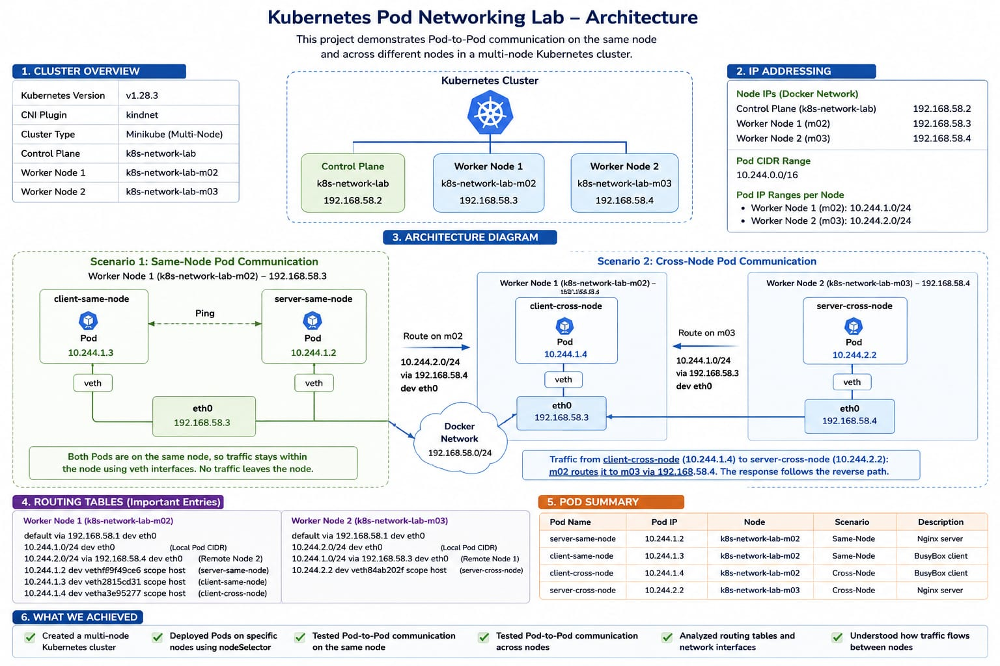
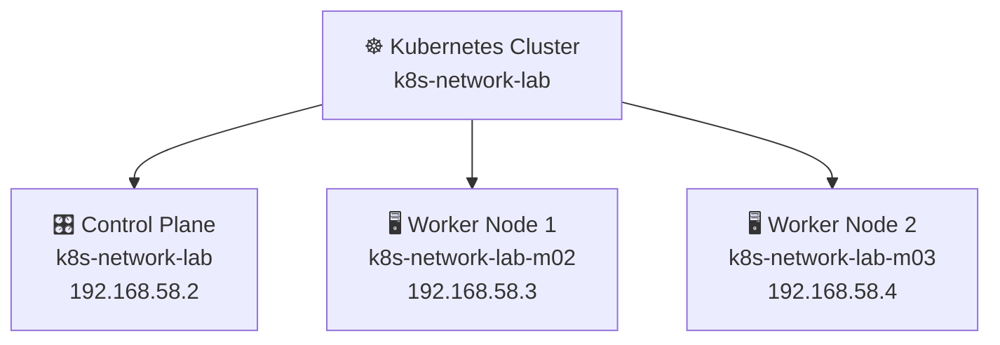
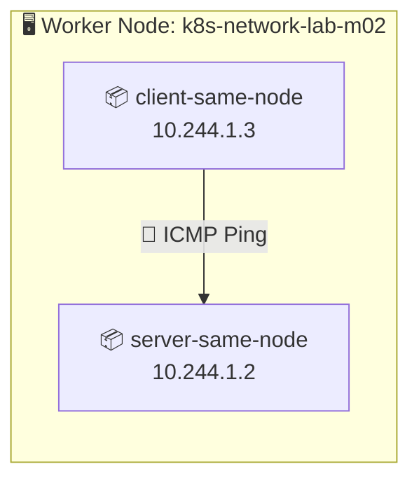
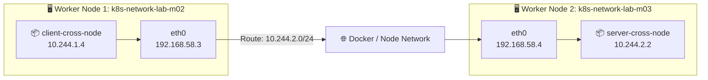
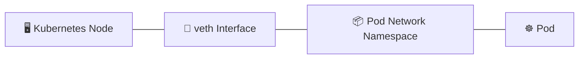

<div align="center">

# 🌐 Kubernetes Pod Networking Lab

### **A Hands-On Multi-Node Kubernetes Networking Project**

<p>
  
  
  
  
  
</p>

<p>
  <b>Same-Node Communication</b> &nbsp;•&nbsp;
  <b>Cross-Node Communication</b> &nbsp;•&nbsp;
  <b>Routing Analysis</b>
</p>

</div>

---

# 🏗️ Project Architecture

<div align="center">



<br>

**Multi-Node Kubernetes Cluster • Same-Node Communication • Cross-Node Communication**

</div>

> 📌 **Architecture Image Location:** `docs/architecture.png`

---

## 📌 Overview

This project is a **hands-on Kubernetes networking lab** built to understand how Pods communicate with each other in a **multi-node Kubernetes cluster**.

Instead of only testing connectivity, this project investigates the actual networking components involved in the communication path, including:

- 🧭 Pod placement
- 📦 Pod IP addressing
- 🖥️ Node IP addressing
- 🔌 `veth` interfaces
- 🛣️ Linux routing tables
- 🌐 Cross-node traffic flow
- ⚙️ Kubernetes CNI networking

The lab compares two important Kubernetes networking scenarios:

> **Scenario 1:** Two Pods communicating on the same Kubernetes node.

> **Scenario 2:** Two Pods communicating across different Kubernetes nodes.

---

# 🏗️ Cluster Architecture

The project uses a **three-node Minikube cluster** with the Docker driver and `kindnet` CNI. Create a profile with the name expected by the manifests, then apply the four standalone Pods:

```bash
minikube start --driver=docker --nodes=3 --profile=k8s-network-lab --cni=kindnet
kubectl config use-context k8s-network-lab
kubectl get nodes -o wide
kubectl apply -f manifests/same-node/
kubectl apply -f manifests/cross-node/
kubectl wait --for=condition=Ready pod --all --timeout=180s
kubectl get pods -o wide
```

The selectors expect worker nodes named `k8s-network-lab-m02` and `k8s-network-lab-m03`. If your Minikube version or profile produces different names, check `kubectl get nodes` and update the selectors in `manifests/` before applying. The Docker driver is needed for the `docker exec` node-inspection examples below. This lab observes basic Pod routing; it does not test NetworkPolicy enforcement.



---

# 🧩 Network Information

The IP addresses and route/interface output in this README are examples captured from one run. Kubernetes assigns Pod IPs dynamically, and node IPs can differ by driver, host, and Minikube profile. Use the commands below to discover the current values before testing.

## 🖥️ Example Node IP Addresses

| Node | Role | IP Address |
|---|---|---|
| `k8s-network-lab` | Control Plane | `192.168.58.2` |
| `k8s-network-lab-m02` | Worker Node 1 | `192.168.58.3` |
| `k8s-network-lab-m03` | Worker Node 2 | `192.168.58.4` |

## 📦 Example Pod Network

| Network | CIDR |
|---|---|
| Cluster Pod CIDR | `10.244.0.0/16` |
| Worker Node 1 Pod Network | `10.244.1.0/24` |
| Worker Node 2 Pod Network | `10.244.2.0/24` |

## 🚀 Example Pod Placement and Addresses

| Pod | Pod IP | Node | Scenario |
|---|---|---|---|
| `server-same-node` | `10.244.1.2` | `k8s-network-lab-m02` | Same Node |
| `client-same-node` | `10.244.1.3` | `k8s-network-lab-m02` | Same Node |
| `client-cross-node` | `10.244.1.4` | `k8s-network-lab-m02` | Cross Node |
| `server-cross-node` | `10.244.2.2` | `k8s-network-lab-m03` | Cross Node |

---

# ① Same-Node Pod Communication

Both Pods are intentionally scheduled on:

```text
k8s-network-lab-m02
```

### 🧱 Architecture



### 🎯 Traffic Flow

```text
client-same-node
10.244.1.3
      │
      │ ping
      ▼
┌─────────────────────────────┐
│ Worker Node m02             │
│                             │
│   veth  ── Linux Network ── veth
│                             │
└─────────────────────────────┘
      │
      ▼
server-same-node
10.244.1.2
```

### 🧪 Connectivity Test

```bash
SERVER_IP="$(kubectl get pod server-same-node -o jsonpath='{.status.podIP}')"
kubectl exec client-same-node -- ping -c 4 "$SERVER_IP"
```

### ✅ Result

```text
4 packets transmitted
4 packets received
0% packet loss
```

> 💡 Because both Pods are located on the same worker node, the traffic stays inside the local node networking stack.

---

# ② Cross-Node Pod Communication

For this scenario, the Pods are placed on different worker nodes:

```text
client-cross-node
        │
        ▼
k8s-network-lab-m02
192.168.58.3


server-cross-node
        │
        ▼
k8s-network-lab-m03
192.168.58.4
```

### 🧱 Architecture



### 🧪 Connectivity Test

```bash
SERVER_IP="$(kubectl get pod server-cross-node -o jsonpath='{.status.podIP}')"
kubectl exec client-cross-node -- ping -c 4 "$SERVER_IP"

# Verify the Nginx server responds over HTTP as well.
kubectl exec client-cross-node -- wget -qO- "http://${SERVER_IP}/"
```

### 🚀 Result

```text
4 packets transmitted
4 packets received
0% packet loss
```

---

# 🛣️ Routing Analysis

One of the main goals of this project was to inspect how the worker nodes route traffic to remote Pod networks.

The route shown below is an example from one Docker-driver cluster. Inspect the current route table rather than expecting the same node IP or interface name.

## On Worker Node 1 (`m02`)

```text
10.244.2.0/24 via 192.168.58.4 dev eth0
```

### Meaning

```text
Destination Network
10.244.2.0/24
        │
        ▼
Next Hop
192.168.58.4
        │
        ▼
Worker Node m03
```

In other words:

> Traffic destined for Pods in the `10.244.2.0/24` network is routed to Worker Node `m03`.

---

## On Worker Node 2 (`m03`)

```text
10.244.1.0/24 via 192.168.58.3 dev eth0
```

### Meaning

```text
Destination Network
10.244.1.0/24
        │
        ▼
Next Hop
192.168.58.3
        │
        ▼
Worker Node m02
```

This route allows return traffic to reach Pods located on Worker Node `m02`.

---

# 🔌 veth Interface Analysis

The worker nodes contain `veth` interfaces connected to Pod network namespaces.

Examples:

### Worker Node `m02`

```text
10.244.1.2 dev vethf9f49ce6 scope host
10.244.1.3 dev veth2815cd1 scope host
10.244.1.4 dev vetha3e5277 scope host
```

### Worker Node `m03`

```text
10.244.2.2 dev veth84ab202f scope host
```

### Conceptual View



> Each Pod has its own network namespace, and the `veth` pair connects the Pod networking environment to the Kubernetes node networking stack.

---

# 🔄 Complete Cross-Node Traffic Flow

```text
┌──────────────────────────────┐
│ client-cross-node            │
│ Pod IP: 10.244.1.4           │
└──────────────┬───────────────┘
               │
               ▼
          veth interface
               │
               ▼
┌──────────────────────────────┐
│ Worker Node m02              │
│ Node IP: 192.168.58.3        │
│                              │
│ Route:                       │
│ 10.244.2.0/24                │
│ via 192.168.58.4             │
└──────────────┬───────────────┘
               │
               ▼
════════════ Docker Network ════════════
               │
               ▼
┌──────────────────────────────┐
│ Worker Node m03              │
│ Node IP: 192.168.58.4        │
└──────────────┬───────────────┘
               │
               ▼
          veth interface
               │
               ▼
┌──────────────────────────────┐
│ server-cross-node            │
│ Pod IP: 10.244.2.2           │
└──────────────────────────────┘
```

---

# ⚙️ Pod Placement with `nodeSelector`

Pod placement was controlled using:

```yaml
nodeSelector:
  kubernetes.io/hostname: k8s-network-lab-m02
```

This allows the project to intentionally control where Pods are scheduled.

### Same-Node Scenario

```text
client-same-node  → m02
server-same-node  → m02
```

### Cross-Node Scenario

```text
client-cross-node → m02
server-cross-node → m03
```

---

# 📂 Project Structure

```text
k8s-network-lab/
│
├── 📄 README.md
│
├── 📁 docs/
│   └── 🖼️ architecture.png
│
├── 📁 manifests/
│   │
│   ├── 📁 same-node/
│   │   ├── 📄 client-same-node.yaml
│   │   └── 📄 server-same-node.yaml
│   │
│   └── 📁 cross-node/
│       ├── 📄 client-cross-node.yaml
│       └── 📄 server-cross-node.yaml
│
```

---

# 🛠️ Technologies Used

| Technology | Purpose |
|---|---|
| ☸️ Kubernetes | Container orchestration |
| 🚀 Minikube | Local multi-node Kubernetes cluster |
| 🐳 Docker | Container runtime and node networking |
| 🌐 kindnet | Kubernetes CNI networking |
| 🐧 Linux Networking | Routing and network interface analysis |
| 📦 BusyBox | Lightweight client container |
| 🌐 Nginx | Server container |

---

# 🔍 Useful Commands

### Check Cluster Nodes

```bash
kubectl get nodes -o wide
```

### Check Pod Placement

```bash
kubectl get pods -o wide
```

### Check Kubernetes Networking Components

```bash
kubectl get pods -n kube-system -o wide
```

### Inspect Worker Node Routing Table

```bash
docker exec k8s-network-lab-m02 ip route
```

```bash
docker exec k8s-network-lab-m03 ip route
```

### Inspect Worker Node Interfaces

```bash
docker exec k8s-network-lab-m02 ip addr
```

```bash
docker exec k8s-network-lab-m03 ip addr
```

### Remove the lab

Delete the Pods and then remove the dedicated Minikube profile:

```bash
kubectl delete -f manifests/same-node/
kubectl delete -f manifests/cross-node/
minikube delete --profile=k8s-network-lab
```

`minikube delete` removes the entire named local cluster and its workloads. Do not use that profile name if it contains work you want to keep.

---

# 🎯 What I Learned

- [x] How to create a multi-node Kubernetes cluster.
- [x] How to control Pod placement using `nodeSelector`.
- [x] How Pods communicate on the same Kubernetes node.
- [x] How Pods communicate across different Kubernetes nodes.
- [x] How to inspect Pod and Node IP addresses.
- [x] How to analyze Linux routing tables.
- [x] How `veth` interfaces connect Pods to nodes.
- [x] How Kubernetes networking routes traffic between worker nodes.
- [x] How to verify connectivity using ICMP `ping`.

---

# 🏁 Conclusion

This lab demonstrates an important Kubernetes networking principle:

> **Pods can communicate using their Pod IP addresses regardless of whether they are located on the same node or on different nodes.**

The main difference is the path taken by the traffic:

| Same Node | Different Nodes |
|---|---|
| Traffic stays inside the local node | Traffic is routed through the node network |
| Uses local networking and `veth` interfaces | Uses routing tables and node interfaces |
| No remote worker node is involved | Traffic travels between worker nodes |

---

<div align="center">

### ⭐ If you found this project useful, consider giving the repository a star!

**Built as a hands-on Kubernetes Networking learning project.**

</div>
